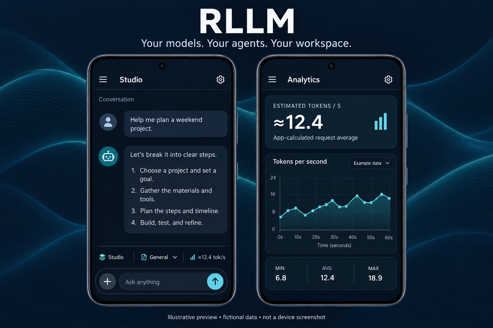

# RLLM

**Your models. Your agents. Your workspace.**

A compact Android harness for local and hosted language models. Keep a conversation while switching connections, choose named agents, route subagents and compaction separately, and inspect measurements collected by the app.

*Illustrative preview, not a device screenshot. Layout and example values are illustrative; no personal addresses, conversations, or performance claims are shown.*

## Install

[Download the current Android test APK](https://github.com/sdfowler1977/RLLM/releases/download/lab-1793154100/RLLM-Lab.apk) · [Setup guide](docs/SETUP.md) · [User guide](docs/USAGE.md)

The publication package also contains the actual APK at [`release/RLLM-Lab.apk`](release/RLLM-Lab.apk). The signed APK is also published as a GitHub pre-release with its SHA-256 checksum.

Requires Android 8.0 or later on ARM64 or x86-64. This is **RLLM Lab**, version `0.1-lab.1793154100`. An LLM runs on your configured server/provider; this APK does not bundle model weights.

## Key-free native web search

Web search defaults to DuckDuckGo HTML with no API key or custom endpoint setup. In Web access, leave **Custom search URL** blank. Normal chat and recursive investigation use the same original Rust HTTP path; a secondary model is optional. Existing custom services keep their separate credentials, which are never sent to built-in search or ordinary page reads.

Search responses are returned as evidence through the existing request/result flow. Known verification pages are reported as unsuccessful retrievals, not accepted as results or automatically retried. Controlled app-level tests cover normal, recursive and secondary-agent routing; live source availability is not certified. No Node, Chromium or third-party engine was added.

## Native PNG and stylesheet capture

The new original Rust renderer produces actual PNG files from supported local HTML/CSS and selected TrueType glyphs. Ask “Capture page.html into preview.png at 800 by 600.” It uses native stylesheet parsing, selectors, author cascade, font-driven layout, quadratic outline painting and PNG encoding. No Node/npm, external REA engine or required computer. See [capture guide](docs/STATIC-CAPTURE.md).

Capture now loads relative workspace CSS and PNG files, applies actual image dimensions and paints decoded pixels. The PNG decoder supports every legal color/depth family, five filters and Adam7. Linked stylesheet order and CSS overrides are preserved.

This is a static subset. Remote resource loading, full browser sessions, JavaScript, richer layout/font shaping and the rest of the universal harness build remain in progress. Existing History, screenshot attachments and all prior capabilities are preserved.

## What you can do

- Add multiple connections with a URL, manually entered model ID, and optional API key. Local and hosted connections use the same form.
- Switch connections from the chat footer without starting a new thread. Use the pencil to edit the current connection.
- Select a named main-agent profile; set separate default subagent and compaction connections.
- Configure provider-aware thinking, output limits, and context budgets.
- Stream visible text from local chat, chat-completions, Messages and Content connections, with per-connection opt-out and complete JSON fallback.
- Explicitly refine an agent using up to four recent adopted lessons as bounded, untrusted examples, with opt-out and visible provenance.
- Manage conversation history and Trash; customize fonts, text size, colors, and background.
- Use reviewed workspace, web, storage, investigation, and delegation tools with profile-specific permissions.
- Read a quiet live `≈tok/s` estimate on the chat screen and tap it to open analytics. App observations and server-reported data remain separate.
- Save supported work to a granted phone folder or a configured WebDAV destination, including a reachable network drive.

## Local and remote LLM connections

Bare local/Tailscale IP addresses now default to HTTP. Explicit HTTP/HTTPS stays as entered; saved URLs are not silently changed. See the short [Tailscale setup and connection troubleshooting guide](docs/CONNECTIONS.md) for remote access, ports and common HTTP/HTTPS errors.

## Tool feedback and web results

Mixed prose and tool JSON now shows explicit format feedback, with raw-response inspection and one user-requested correction. A corrected bare-JSON proposal still requires approval. Blocked, rejected, cancelled and failed web operations retain distinct bounded outcomes; they are not silently described as successful fetches. See [tool feedback](docs/TOOL-FEEDBACK.md).

`web_read` fetches static content. JavaScript rendering, browser screenshots, clicks and typing are not implemented by this fix.

## Phone access and app inspection

- **Files and access** requests Android broad shared-storage access once, with selected-folder and off controls. Android must grant access; other apps' private files remain protected by Android.
- **App inspection** reads a catalog only on request. Select an app, optionally exclude sensitive packages, then explicitly read version/UID and permission metadata. Disable inspection to clear current observations. Results are not automatically sent to an LLM. Selected-app usage is a separate off-by-default option on Android 15+, with explicit usage-access grant and bounded 24-hour/seven-day retained event counts. These counts are not elapsed runtime, CPU monitoring, private-data access or spyware detection.
- Malformed leading tool-call markup now shows a clear format error with raw-response inspection. It never executes embedded tool JSON or automatically retries. Explaining the REA workflow requires no discovery call.
- Footer and menu spacing improvements, bounded reviewed MCP lifecycle/identity/control handling and explicit local/Content model metadata reads are included.

Read [Access and data controls](docs/ACCESS-AND-DATA.md) before granting access. These capabilities are intentional features with controls; unintended disclosure remains a bug. A compromised model runtime or remote endpoint can mishandle data. Data sent to a configured provider does not stay inside this app.

## Start in a few minutes

1. Install the test APK, keeping an existing Lab installation and its data.
2. Tap **Connect to LLM**, or the pencil if already configured.
3. Enter a connection name, exact API URL, model ID, and key if required.
4. Choose the API format supported by your server. For an OpenAI-compatible chat server, choose **OpenAI-compatible chat** and use its `/v1` base URL.
5. Save, send a short message, and use the footer to change the connection or main agent.

See [Setup](docs/SETUP.md) for HTTP versus HTTPS, provider formats, storage, and troubleshooting.

## Documentation

| Guide | Contents |
| --- | --- |
| [Setup](docs/SETUP.md) | Installation, connections, model routes, storage, web access |
| [Daily use](docs/USAGE.md) | Chat, profiles, history, appearance, tools, refinement |
| [Analytics](docs/ANALYTICS.md) | Local rate formula, timing, errors, reported metrics |
| [Build](docs/BUILD.md) | Toolchain, native build, signing, core checks |
| [Architecture](docs/ARCHITECTURE.md) | Rust core, Android bindings, effects and permissions |
| [iOS assessment](docs/IOS.md) | Reusable code, required port, build/distribution prerequisites |
| [Test-build notes](release/NOTES.md) | Exact artifact, validation, known review status |
| [Publication](docs/PUBLICATION.md) | Repository and direct-release publication steps |

## Development status

The Android app is an active test build. Independent focused headless tests cover format correction, approval, real TCP web fetching, captured results and originating-model continuation. The signed package is checked against an independent rebuild of both ABIs, DEX and resources. Current installed-device, accessibility, live-provider and full-project acceptance remain open, as does the previously disclosed archive-import independent review. See [release notes](release/NOTES.md).

No iOS build or voice/open-microphone feature is included. Full MCP/ACP/A2A, OAuth, broader storage and local inference/compiler work remain unfinished. Adopted lesson reuse is explicit and bounded; no automatic training or background learning is claimed.

## Source and notices

The application core is Rust, with Android Java bindings and a small JNI bridge. There is no browser/WebView UI. The public package omits private configuration, credentials, internal work logs, and personal screenshots. Required asset/runtime notices are retained in [`notices/`](notices/) and described in [asset provenance](docs/ASSETS.md). A project-wide reuse license has not been selected; no new license grant is implied by publication.

## Native investigation

Original Rust document structure, local byte comparison, RIFF/WAVE format observations and WebAssembly section observations now connect to ordinary and recursive task result paths. No separate REA program or required remote analysis server. See [native investigation](docs/NATIVE-INVESTIGATION.md) and the [full retained scope](docs/INVESTIGATION-SCOPE.md). Rendered browser capture and the full universal engine remain in development.

## History and phone attachments

History now shows readable conversation cards with previews and direct Delete controls. Deleting the last conversation leaves an empty History, including after restart. Deleted conversations can be restored from Trash.

Use **+ → Attach image or text file** to select a PNG/JPEG screenshot or UTF-8 text document. Images appear above the composer with a Remove control and are sent as image parts to the selected provider. Text files append to your draft. See [attachment and History guide](docs/HISTORY-AND-ATTACHMENTS.md).
