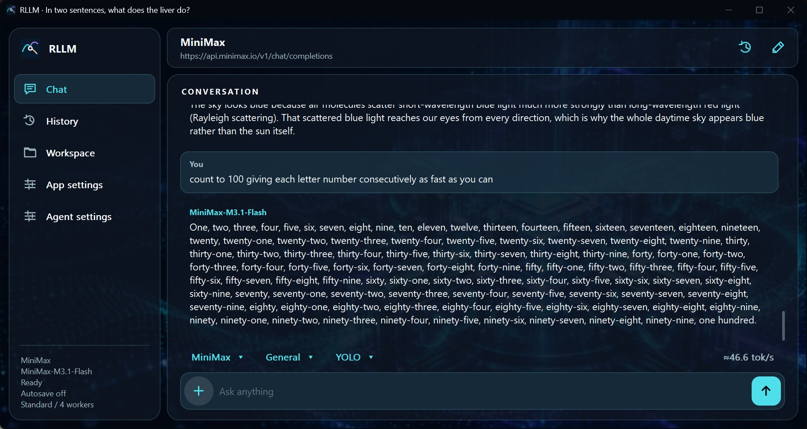
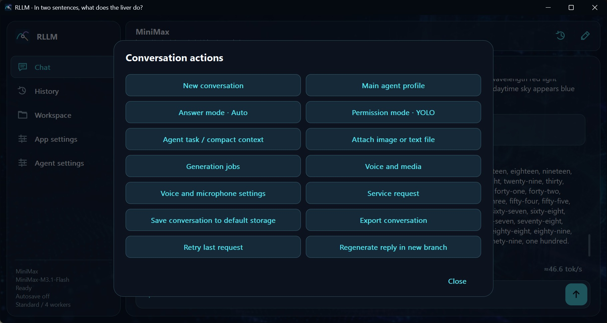
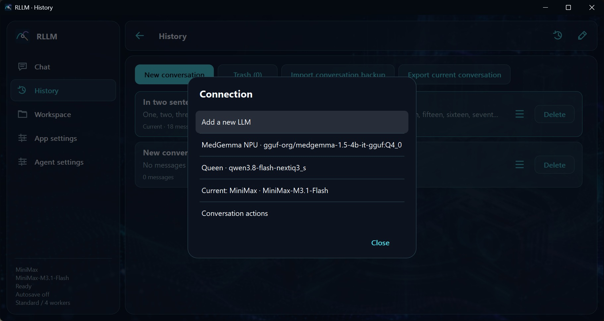
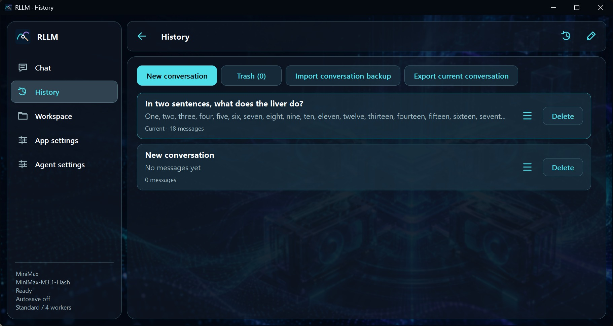
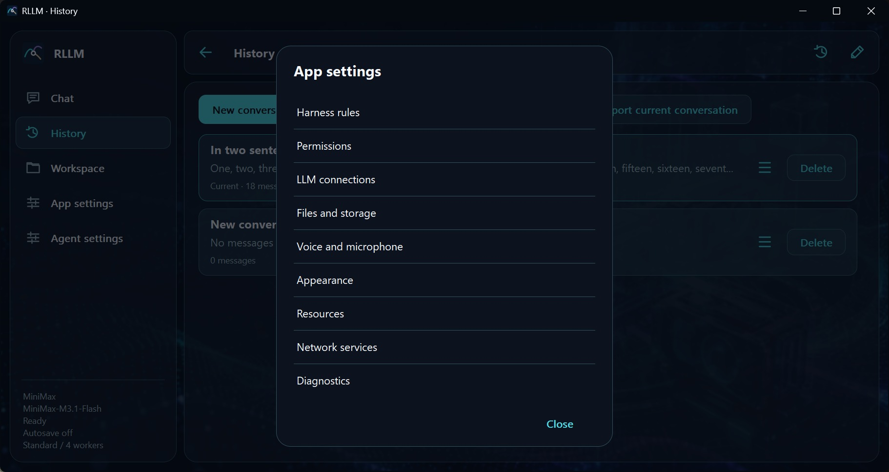
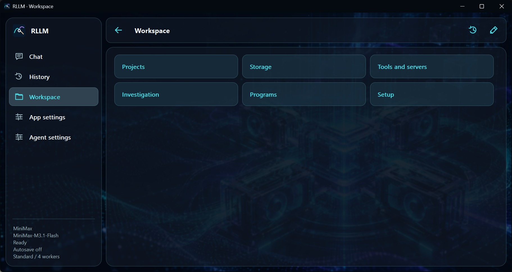

# RLLM

**Your models. Your devices. One app.**

RLLM is a native client for large language models that runs on Android phones and Windows on ARM PCs from a single Rust core. Point it at a model you run yourself or at a hosted API, and you get a fast, focused place to chat, delegate work to agents and keep your history — without a browser shell, a web runtime or an RLLM account in the middle.

## Why RLLM

- **Bring any model.** Save as many connections as you need and switch between them from the chat bar. The connections shown below include MedGemma served from this laptop's Snapdragon NPU, a Qwen model and MiniMax's hosted API, side by side.
- **Replies stream as they are written.** Text arrives token by token with a live tokens-per-second readout, so you always know how your model is performing.
- **Truly native on both platforms.** On Windows, RLLM is a real Win32 window drawn by the Rust core: no WebView, no Electron, no console window. On Android it is a native Android app built on the same core.
- **Private by design.** Conversations and connection keys are sealed with AES-256-GCM on the device. There is no RLLM account and no RLLM-run server; requests go to the model endpoints and services you configure.
- **Your history, under your control.** Move conversations to trash and restore them, export a conversation to a backup file and import it again, retry the last request, or regenerate a reply in a new branch.
- **You decide what the agent may do.** Choose a permission mode from Ask to YOLO, and manage harness rules, agent profiles, default models, skills and tool access from Agent settings.
- **Signed builds.** The Windows executable is Authenticode-signed by RLLM and timestamped. The Android APK is signed with the RLLM application key (APK Signature Scheme v2 and v3).

## Screenshots

All screenshots are unedited captures of RLLM running on a Surface Laptop 7 (Windows 11 on ARM, Snapdragon X Elite).

| | |
|---|---|
|  |  |
| **Conversation actions** — new conversations, answer and permission modes, attachments, export, retry and branching in one place. | **Connections** — a local NPU model, a Qwen model and a hosted API, one click apart. |
|  |  |
| **History** — trash, backup import and export for every conversation. | **App settings** — connections, permissions, storage, appearance, network services and diagnostics. |

**Workspace** — projects, storage, tools and servers, investigation, programs and setup.

## Download

| Platform | File | Details |
|---|---|---|
| Android 8.0 or later (ARM64, x86-64) | [`RLLM-Lab-1795217278.apk`](https://github.com/sdfowler1977/RLLM/releases/download/RLLM__Windows-Installers__2026-11-20__21-35-25Z/RLLM-Lab-1795217278.apk) | Package `com.local.client.lab`, 4,708,301 bytes. Signing certificate SHA-256 `ba3d016eb002221f6305378f9efe9b7dd9531a525bad8044cedd2cf63a3dbbd5`. |
| Windows 10 or 11, ARM64 or x64 | [`RLLM-Setup.exe`](https://github.com/sdfowler1977/RLLM/releases/download/RLLM__Windows-Installers__2026-11-20__21-35-25Z/RLLM-Setup.exe) | One installer for both kinds of PC: it detects the processor and installs the native ARM64 or x64 build. |
| Windows 10 or 11, x64 | [`RLLM-Windows-x64.zip`](https://github.com/sdfowler1977/RLLM/releases/download/RLLM__Windows-Installers__2026-11-20__21-35-25Z/RLLM-Windows-x64.zip) | A smaller package to send to x64 PCs: `RLLM-Setup-x64.exe`, a short read-me and the public certificate. |
| Windows, no installer | [`RLLM-Desktop-arm64.exe`](https://github.com/sdfowler1977/RLLM/releases/download/RLLM__Windows-Installers__2026-11-20__21-35-25Z/RLLM-Desktop-arm64.exe) · [`RLLM-Desktop-x64.exe`](https://github.com/sdfowler1977/RLLM/releases/download/RLLM__Windows-Installers__2026-11-20__21-35-25Z/RLLM-Desktop-x64.exe) | A single executable to run from any folder, with no runtime to add. |

The installers set RLLM up for the current user only, so no administrator rights are needed. They add Start menu and desktop shortcuts and an entry under **Settings > Apps > Installed apps**, from which RLLM can be removed; removal keeps your conversations and settings. All Windows files are signed by `RLLM`; the public certificate is [`release/RLLM.cer`](release/RLLM.cer).

The Windows signing certificate is issued by RLLM itself rather than by a public certificate authority, so on a new PC Windows SmartScreen shows "Windows protected your PC" with the publisher as unknown. Choose **More info**, then **Run anyway**. To make Windows recognise the publisher permanently, import `RLLM.cer` into **Trusted Root Certification Authorities** and **Trusted Publishers** (double-click the file and choose **Install Certificate**). Only do this if you trust the source of the download.

**Platform note.** Voice and microphone sessions, phone access, document-tree storage and cloud storage accounts are currently available on Android only.

Build instructions for both platforms are in [docs/BUILD.md](docs/BUILD.md).

## Feature details

The Windows installers are signed candidate 1795208207. They add the Windows on ARM desktop app, HTTPS on Windows and compatibility with MiniMax's streaming replies, on top of the MCP connections, conversation menu, web search, transport and authorization changes described in the release notes. The Android download is package 1795217278, a smaller build of the same app for ARM64 and x86-64. Owner validation, unavailable historical comparisons and pending device/independent acceptance are recorded separately.

RLLM connects your Android device to configured language models and integrates investigation into ordinary command following.

Configured models and callable-agent routes appear in the request catalog. Reviewed delegation returns the actual child response or error to the captured parent. Question/design records connect plans, source observations, interpretations, finite checks and implementation decisions.

Start an investigation by telling the assistant what to examine; the editable plan and hypothesis forms are optional. Permitted model operations can record findings and implementation-language constraints in the same journal. A design brief can be read by the model or exported as Markdown without raw returned source/output bodies, alongside the existing complete journal JSON. Authored text may still quote sources; a brief does not establish separate analysis and implementation contexts. See [Question and design process](docs/QUESTION-PROCESS.md).

The app includes four provider formats, incremental replies, user agent/skill settings, file inspection/comparison, typed binary evidence, web search/page capture, reviewed reconstruction/experiments, WebDAV storage, encrypted history and local MCP/A2A access.

Use **Config → Network services → MCP connections** to save and switch servers. Discovery, calls and streams use the active connection. Use **Web access → Always allow built-in web search** to allow built-in searches without per-query prompts. Tap a compact web result or tool request in conversation to see its details. The plus menu opens with **New conversation**.

The separately supplied signed APK matches this source; its SHA-256 is recorded in PUBLICATION-MANIFEST.json. Build instructions are in [docs/BUILD.md](docs/BUILD.md), command behavior in [docs/COMMANDS.md](docs/COMMANDS.md), and recorded validation in [verification/RESULTS.json](verification/RESULTS.json).

Voice controls are in **App settings → Voice and microphone**, and are also reachable from Conversation actions and Voice and media. Save microphone preferences without configuring a model or speech server. Configure optional recognition and speech-output connections, choose **Review open microphone conversation**, review the destinations and listening options, then enable the session. A speech-output key alone does not provide recognition. Microphone capture and silence detection run in the app; speech-to-text uses your chosen server and no recognition model is bundled. Background listening remains a separate reviewed option. See [voice setup](docs/SERVICES.md#voice-and-microphone-settings).

Optional provider-neutral server capabilities now support foreground open-microphone conversation, explicit Speak now interruption, optional foreground spoken interruption with device echo control, and manual voice turns, file uploads, an interactive static GLB viewport with embedded PNG textures and alpha cutouts, image/video/scene/document routes, ordered fallbacks and tracked generation jobs. Setup and limits are in [docs/SERVICES.md](docs/SERVICES.md). Optional S256 browser authorization supports owned automatic credential refresh and pending-browser recovery while retaining API-key mode. Standalone read-only ACP v1 sessions use the shared workspace engine. Headless tasks discover bounded usable CPU concurrency when device metadata is absent. All extra services remain optional. Current candidate validation and any unavailable checks are recorded separately from the preserved baseline.

Pending authorization replies belong to the saved credential generation that initiated them. Replacing tokens at the same destination retires older replies while retaining explicit manual credentials and current sign-in/refresh recovery.
