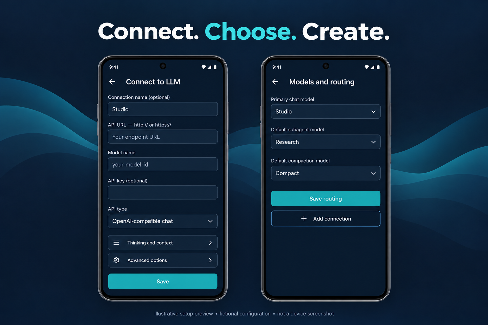

For a private server away from home, see [Tailscale setup and connection troubleshooting](CONNECTIONS.md). Tailscale or another secure VPN/tunnel can provide access; it is not required for public hosted APIs or already reachable LAN servers.

## Current access and inspection controls

See [Access and data controls](ACCESS-AND-DATA.md) for broad shared-storage, selected-folder and disabled modes; explicit selected-app metadata reads; exclusions; and model data destinations. App inspection does not access private app files or prove spying. Leading malformed tool-call markup is a scoped error, with raw history retained and no execution/replay. This section supersedes older folder-only browsing descriptions below.

# Set up RLLM

## 1. Install Android

Download [RLLM-Lab.apk](https://github.com/sdfowler1977/RLLM/releases/download/lab-1793150000/RLLM-Lab.apk) from the GitHub pre-release. Open the APK on a compatible Android 8.0+ ARM64 or x86-64 device and follow Android's installation prompts. If Android asks, allow installation for the browser or file manager you used; this is not permission for RLLM to install other apps.

For an existing **RLLM Lab** installation, install the newer APK over it. Do not uninstall or clear storage to resolve an update error: that can remove local history. A signature mismatch means the APK was signed by a different key. Keep the original installation and check the artifact first. The publisher's Lab package is `com.local.client.lab`.

The application needs access to your selected model endpoint. A server on another device must listen on a reachable interface, allow the port through its firewall, and be reachable through your LAN/VPN. The phone's `localhost` refers to the phone itself.

## 2. Add a connection



*Generated setup illustration, not a captured device screen. Follow the text instructions and actual form labels; do not treat the illustrated values as working credentials.*

Tap **Connect to LLM** on first launch. Later, the top pencil opens the current connection editor directly. Additional connections are available through **App settings → LLM connections**, or the chat connection picker’s add option.

| Field | What to enter |
| --- | --- |
| Connection name | A friendly label such as `Studio` or `Research`. If populated, this is displayed instead of the wire model ID. |
| API URL | The exact address, including `http://` or `https://`, port if needed, and API path. |
| Model name | The provider's exact model ID. Type it manually; `RLLM` is the app's name, not a default model. |
| API key | Your provider's key, if required. Leave empty for a server that does not require one. |
| API type | The request format the server actually accepts. |

Example local configuration, using a reserved documentation address rather than anyone’s real server:

```text
Connection name: Studio
API URL:         http://192.0.2.10:8080/v1
Model name:      your-model-id
API key:         leave blank if your server needs no key
API type:        OpenAI-compatible chat
```

**Replace the example address and model ID.** `192.0.2.10` is documentation-only and is not an accessible demo service.

Example hosted configuration:

```text
Connection name: Research
API URL:         https://api.example.com/v1
Model name:      provider-model-id
API key:         enter your own key in the app
API type:        OpenAI-compatible chat
```

`api.example.com` is illustrative. Use the endpoint and API format documented by your chosen provider; an API key alone does not make a provider compatible with a particular format.

### Choose the correct API format

| API type in RLLM | Typical resolved request path | Authentication default |
| --- | --- | --- |
| OpenAI-compatible chat | `/v1/chat/completions` | `Authorization: Bearer …` |
| Ollama chat | `/api/chat` | Bearer key if supplied |
| Anthropic messages | `/v1/messages` | `x-api-key` |
| Google content | `/v1beta/models/{model}:generateContent` | `x-goog-api-key` |

For OpenAI chat, a URL ending in `/v1` is expanded to `/v1/chat/completions`. The older `/v1/completions` text endpoint is a different API. A custom full path is preserved. Advanced options expose streaming and custom authentication header/prefix controls; change these only when the service requires them. All four text API formats now support streaming. Turn off **Stream replies** for a server that requires complete JSON. Messages keeps its required output-token setting. Content standard method URLs switch between `:streamGenerateContent?alt=sse` and `:generateContent` only for the request; the saved connection remains intact. Custom paths and unrelated query fields remain, while conflicting/duplicate `alt` settings are refused before sending.

Use the actual scheme supported by the server. A plain HTTP listener cannot accept HTTPS merely because an `s` is added to its URL. Explicit `http://` is supported for a trusted LAN/VPN; hosted connections should use the provider's documented HTTPS endpoint.

Save and send a short test message. The configured model receives the conversation through the selected connection. Switching providers can therefore send the retained conversation to the new provider.

## 3. Set model roles and agent profiles

Open **Agent settings → Default models**. Choose a primary chat connection, a default subagent connection, and a default compaction connection, then **Save routing**. The latter two can inherit the primary route or use separate saved connections.

Explicit subagent/compaction routes take precedence for those roles. An inherited primary route follows the conversation's explicit connection choice, then a selected agent's model override, then the selected connection. A different connection uses its own endpoint, key, model, and generation settings.

In **Agent settings → Agent profiles**, name a profile, enter its instructions, choose its model override, select skills and callable subagents, and specify permitted tools. Select a main agent from the centered footer control, initially **General**. Profiles and tool permissions cannot be changed in the middle of an active task or pending tool review.

## 4. Thinking and context

Open the pencil, then **Thinking and context**. Leave settings at server defaults unless the exact model/API supports the selected parameters. Set an output-token limit independently from the context budget. A context budget is an application limit; it does not increase the model server's capacity. Estimated-token and exact UTF-8 byte budgets are distinct. The compaction reminder does not automatically discard conversation history or perform compaction.

Apply the generation settings to the connection and save the connection. If a server rejects a reasoning parameter, return to **Server default** and confirm which parameter the provider supports.

## 5. Storage

Open **App settings → Storage**. The current built-in choices are a WebDAV folder or a phone folder granted through Android's file picker.

For WebDAV, enter the complete folder URL, username and password. Use HTTPS where supported. A network drive reached through a VPN still needs a WebDAV service and the correct folder path; a VPN address by itself is not an SMB or WebDAV service. Direct SMB and a built-in Google OAuth Drive connection are not completed in this build.

For phone storage, choose **Grant or change phone folder**, select the destination in Android's picker, and explicitly enable it as the default. Enable autosave if you want each completed reply saved to the selected supported destination. Check that a test reply appears there. The app uses destination readback for its supported verified transfers.

Conversation/configuration exports can also use Android's document picker. Google Drive appears there only if the installed Drive provider exposes a suitable destination; this is Android document-provider access, not built-in Google account authorization. Local encrypted app state remains on the phone even when reply autosave uses remote storage.

## 6. Web access and investigation

A local LLM does not need its own browser connection. The harness can perform permitted, reviewed web operations. Configure **App settings → Network services → Web access** with a search API URL containing `{query}` and any required separate search key/header. Permit `web_read` and/or `web_search` in the relevant agent profile. The current tools fetch/search content; they are not a full Playwright browser session and do not automatically interact with arbitrary JavaScript sites.

Investigation is inherent in ordinary and recursive requests. Ask your question normally; the model can use the harness's original Rust file/document inspection and comparison operations and receive their actual findings. No separate skill invocation or remote REA server is needed for these native engines. **Investigation preferences** edits optional additional guidance. A configured remote MCP connection remains a separate optional capability. See [native investigation](NATIVE-INVESTIGATION.md) for implemented readers and the full retained scope.

## Troubleshooting

| Symptom | Check |
| --- | --- |
| TLS/handshake failure | Verify HTTP versus HTTPS and the certificate. Do not disable certificate validation as a workaround. |
| HTTP 404 | Confirm API type and path. A 404 alone does not prove that a key is valid; some services mask authorization failures. |
| HTTP 401/403 | Check the key, header format, account permission and requested model access. |
| No connection/timeout | Check VPN/LAN reachability, host binding, firewall and port. |
| Model rejected | Enter the exact supported model ID and review optional generation settings. |
| Stream fails but ordinary reply works | Try disabling streaming in Advanced options to isolate server streaming compatibility. |
| No live rate | Wait for received text. Nonstreaming replies show a completed estimate only after the response arrives. |
| Cannot find chats | Use History in navigation or the top history control. Deleted chats are in Trash until permanently removed. |
| APK will not update | Check package, architecture, version and signing identity. Preserve the installed app and data. |

See [test-build notes](../release/NOTES.md) for current archive-import review and device-verification status.
